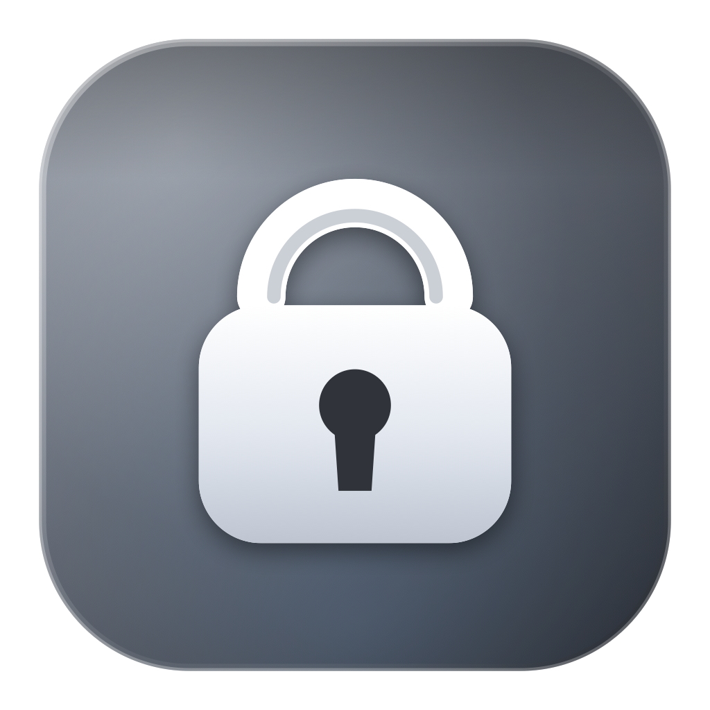
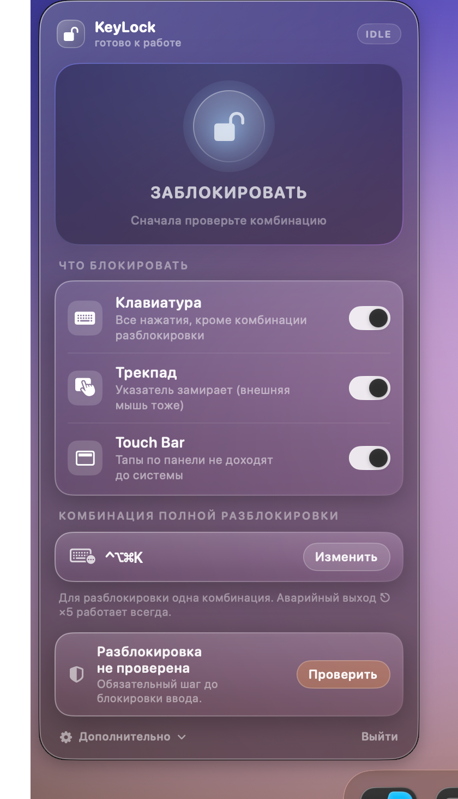
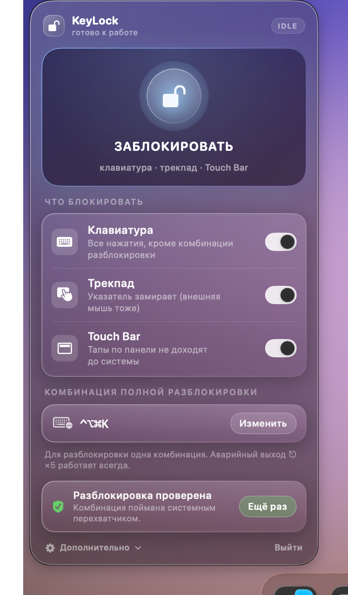
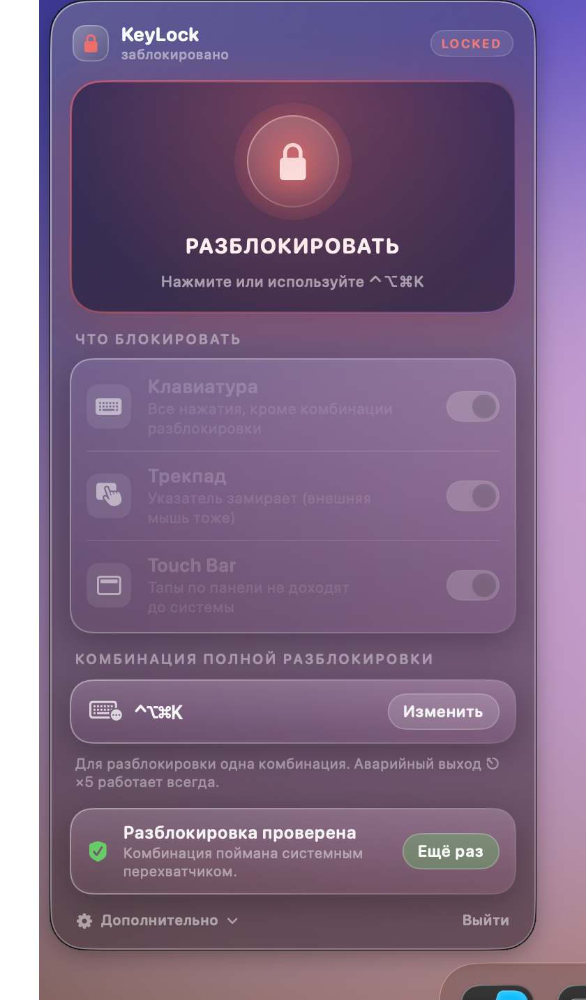
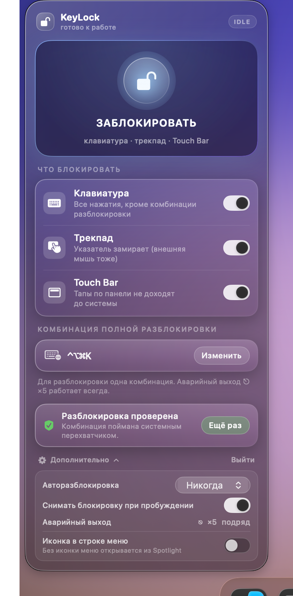

# KeyLock

<p align="center">
  
</p>

<p align="center">
  <b>Серая «жидкое стекло» панель в строке меню, которая блокирует клавиатуру, трекпад и Touch Bar —
  и снимает блокировку одной комбинацией клавиш.</b><br>
  <sub>A macOS menu-bar app that blocks the keyboard, the trackpad and the Touch Bar, and unlocks with a hotkey.</sub>
</p>

---

## Зачем

Иногда нужно, чтобы Mac перестал реагировать на ввод: протереть клавиатуру, оставить ноутбук
ребёнку, посмотреть фильм, чтобы кот не нажал ничего лишнего. KeyLock делает ровно это —
и, что важнее, **гарантированно возвращает управление обратно**.

## Скриншоты

Все скриншоты сняты на macOS 26 (Tahoe) поверх тестовых обоев — так видно, что панель
действительно стеклянная.

| Не проверено | Готово к блокировке |
| :--: | :--: |
| [](docs/screenshots/01-unverified.png) | [](docs/screenshots/02-ready.png) |

| Заблокировано | Дополнительные настройки |
| :--: | :--: |
| [](docs/screenshots/03-locked.png) | [](docs/screenshots/04-advanced.png) |

## Что умеет

- **Большая кнопка-иконка** в верхней части меню. Одно нажатие — 3‑2‑1 — и выбранное блокируется.
  Во время отсчёта блокировку можно отменить (`⎋` или сама комбинация разблокировки).
- **Клавиатура** — перехват всех нажатий, кроме комбинации разблокировки.
- **Трекпад** — указатель замирает: движение, клики, скролл и жесты не доходят до системы.
- **Touch Bar** — тапы по сенсорной панели не доходят до системы.
- **Своя комбинация разблокировки** — рекордер прямо в меню, по умолчанию `⌃⌥⌘K`
  (в русской раскладке отображается как `⌃⌥⌘Л` — физическая клавиша та же).
- **Авторазблокировка** — никогда / 1 / 5 / 15 минут.
- **Снятие блокировки при пробуждении Mac** (включено по умолчанию).
- **Скрываемая иконка в строке меню** — если она не нужна, меню открывается через Spotlight.

## Безопасность — главное в этом приложении

KeyLock специально спроектирован так, чтобы **нельзя было случайно остаться без клавиатуры**.

1. **Проверка комбинации обязательна и сбрасывается при каждом запуске.**
   Пока вы не нажмёте свою комбинацию в режиме проверки (при этом ничего не блокируется),
   большая кнопка не сработает. Так исключается ситуация «заблокировал и не знаю чем снять».
2. **Аварийный выход `⎋` ×5.** Пять осознанных нажатий Escape в течение 3 секунд снимают
   блокировку всегда, независимо от настроек. Удержание Escape не считается — авто-повтор
   отфильтрован.
3. **Отсчёт 3‑2‑1** перед блокировкой с возможностью отмены.
4. **Самовосстановление перехватчика.** Если macOS отключает event tap (слишком медленный
   колбэк), KeyLock включает его обратно, а после пяти таких случаев — сам снимает блокировку.
5. **Реакция на отзыв разрешения.** Если «Универсальный доступ» отозван во время блокировки —
   блокировка немедленно снимается.
6. **Реакция на «Безопасный ввод».** Пока другой процесс держит Secure Input (окна паролей),
   система не отдаёт нажатия перехватчику — значит комбинацию разблокировки увидеть нельзя.
   KeyLock в этом случае сразу снимает блокировку.
7. **Выход/завершение/сигнал.** Выход из приложения, `SIGTERM` и `SIGINT` снимают блокировку.
   Аварийное завершение процесса тоже безопасно: event tap и захват курсора исчезают вместе с ним.
8. **Клавиша питания не перехватывается** аппаратно — удерживая её, Mac всегда можно выключить.

## Как это работает

| Что | Чем |
| --- | --- |
| Перехват клавиатуры | `CGEventTap` уровня `kCGHIDEventTap` (`headInsertEventTap`), подавление `keyDown/keyUp/flagsChanged` |
| Блокировка трекпада | Подавление указательных событий в том же перехватчике + принудительный `CGWarpMouseCursorPosition` в точку блокировки на каждом событии |
| Блокировка Touch Bar | Подавление событий `kCGEventSystemDefined` (тапы по Touch Bar приходят именно так) + `DFRSetStatus(0)` как best-effort |
| Комбинация разблокировки | Сравнение keyCode и нормализованных модификаторов **до** любого подавления |
| Панель | AppKit `NSPanel` + `NSVisualEffectView` (материал `hudWindow`) + SwiftUI; на macOS 26 большая кнопка использует настоящий Liquid Glass (`.glassEffect`) |

### Почему трекпад блокируется вместе с мышью

Три способа сделать «только трекпад» были проверены на macOS 26 и **не работают** без root
или приватных entitlement'ов:

- `IOHIDDeviceOpen(..., kIOHIDOptionsTypeSeizeDevice)` возвращает `kIOReturnSuccess`, но
  эксклюзивного доступа не даёт (повторный seize из того же процесса тоже успешен — значит
  флаг просто игнорируется);
- `IOHIDEventSystemClientRegisterEventFilterCallback` (приватный, но именно он умеет резать
  события по конкретному устройству) возвращает `false` для непривилегированного процесса;
- `CGEvent` не несёт информации об устройстве-источнике, поэтому на уровне event tap'а
  отличить встроенный трекпад от внешней мыши нельзя.

Поэтому переключатель «Трекпад» подавляет **весь указательный ввод**. На MacBook это ровно то,
что нужно; если подключена внешняя мышь — она тоже перестанет работать, о чём честно написано
в подписи пункта меню.

### Почему Touch Bar можно заблокировать

Тапы по Touch Bar приходят в систему как события `kCGEventSystemDefined` (проверено логом
перехватчика: 54 события за 25 секунд тапанья, ни одного `keyDown`). Их подавление убирает
реакцию панели. Дополнительно вызывается приватный `DFRSetStatus(0)` — на macOS 26 он, судя по
всему, ничего не меняет, но на более старых системах может гасить панель визуально.

## Требования

- macOS 13 или новее (проверено на macOS 26.7, Intel MacBook Pro 16,1).
- Разрешение **«Универсальный доступ»** (Privacy & Security → Accessibility).
  Без него `CGEventTap` невозможно создать, и KeyLock честно откажется блокировать.

## Установка

### Вариант 1 — готовая сборка

Скачайте `KeyLock-1.0.0.zip` со [страницы релизов](https://github.com/AlexPogyl/KeyLock/releases),
распакуйте и перетащите `KeyLock.app` в «Программы». Сборка подписана ad-hoc, поэтому
карантин нужно снять вручную:

```bash
xattr -dr com.apple.quarantine /Applications/KeyLock.app
open -a /Applications/KeyLock.app
```

### Вариант 2 — из исходников

Xcode не нужен, достаточно Command Line Tools:

```bash
git clone https://github.com/AlexPogyl/KeyLock.git
cd KeyLock
./scripts/build.sh              # универсальный бинарник (x86_64 + arm64) в ./build
cp -R build/KeyLock.app /Applications/
open -a /Applications/KeyLock.app
```

Приложение подписано ad-hoc, поэтому при первом запуске macOS может попросить подтверждение
(Gatekeeper). Ничего страшного — это локальная сборка.

## Использование

1. Запустите KeyLock — панель откроется сразу (и позже по клику на иконку в строке меню или
   через Spotlight).
2. Выдайте разрешение «Универсальный доступ».
3. Задайте комбинацию разблокировки и нажмите **«Проверить»**, затем нажмите саму комбинацию.
   Должна появиться зелёная плашка «Разблокировка проверена».
4. Выберите, что блокировать.
5. Нажмите большую кнопку. Через 3 секунды ввод отключится.
6. Снять блокировку: комбинация из шага 3 либо `⎋` пять раз подряд.

Если иконка в строке меню не нужна — выключите её в «Дополнительно». Меню всё равно можно
открыть: `⌘+Пробел` → `KeyLock` → `Enter`.

## Разработка

```
Sources/KeyLock/
  Application.swift      точка входа
  AppDelegate.swift      status item, панель, обработка повторного запуска
  LockController.swift   состояние, настройки, блокировка/разблокировка
  EventTap.swift         CGEventTap: подавление ввода и комбинация разблокировки
  TouchBarController.swift  best-effort управление Touch Bar (DFRFoundation)
  MenuView.swift         интерфейс (серое жидкое стекло)
  Hotkey.swift           модель комбинации и перевод keycode → символ
  HUD.swift              всплывающие подсказки поверх экрана
  Permissions.swift      «Универсальный доступ»
  SelfTest.swift         автотест логики на синтетических событиях
  DemoBackdrop.swift     обои для скриншотов

scripts/build.sh         сборка .app
scripts/make-icon.swift  генератор иконки (CoreGraphics)
scripts/screenshots.sh   генерация скриншотов для README
tools/                   диагностические утилиты (HID-проба, лог событий)
```

Полезные флаги:

```bash
# сквозной автотест на синтетических событиях: перехват, комбинация, ⎋×5, курсор, Touch Bar
./build/KeyLock.app/Contents/MacOS/KeyLock --selftest

# открыть панель поверх тестовых обоев (для скриншотов)
./build/KeyLock.app/Contents/MacOS/KeyLock --demo --state ready --backdrop
```

## Известные ограничения

- Блокировка указателя не различает трекпад и внешнюю мышь (см. выше).
- Touch Bar гасится только на уровне событий; визуально панель может оставаться подсвеченной.
- Если приложение пересобрать, macOS может потребовать выдать разрешение «Универсальный доступ»
  заново — это особенность ad-hoc подписи, а не баг.
- KeyLock — инструмент самодисциплины, а не защита от злоумышленника: удерживая кнопку питания,
  Mac всегда можно выключить.

## Лицензия

MIT — см. [LICENSE](LICENSE).
